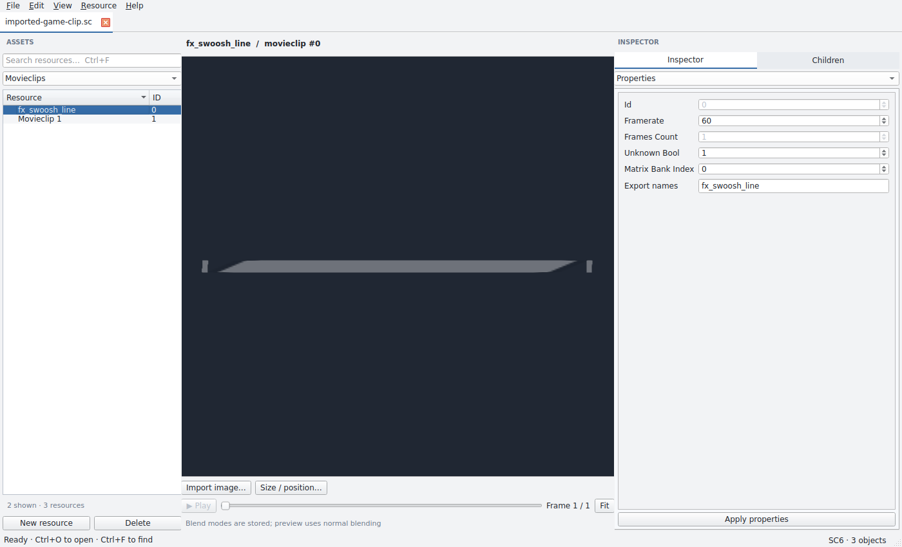
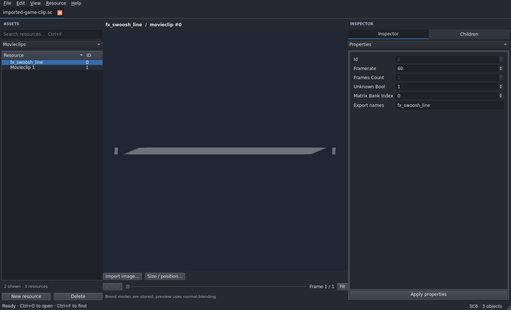
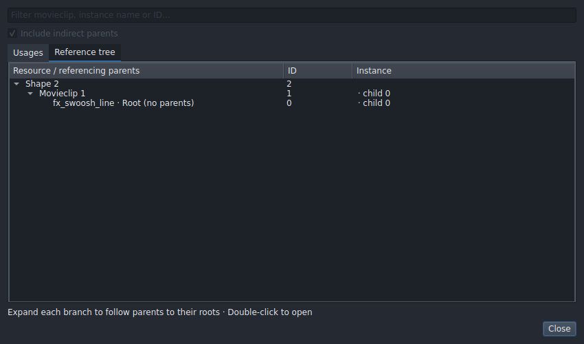
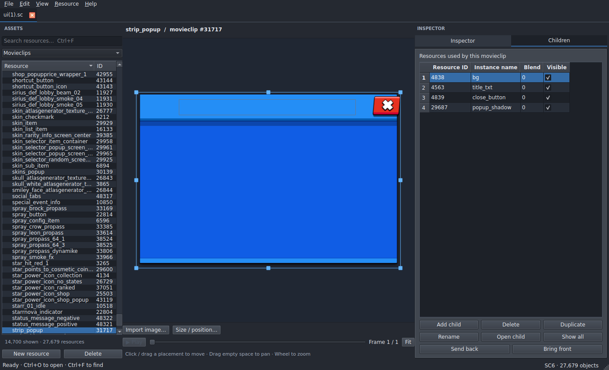
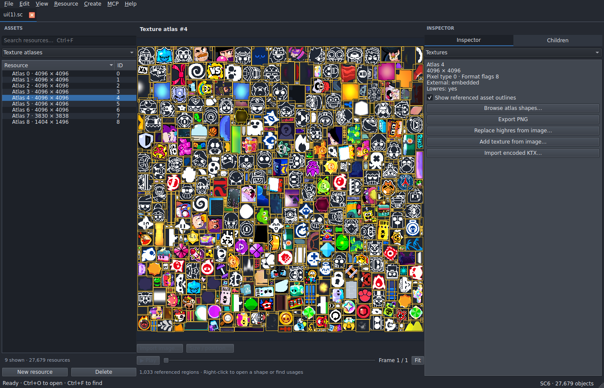
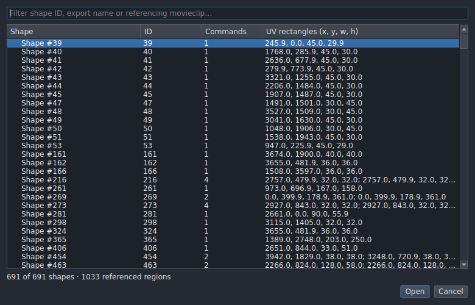
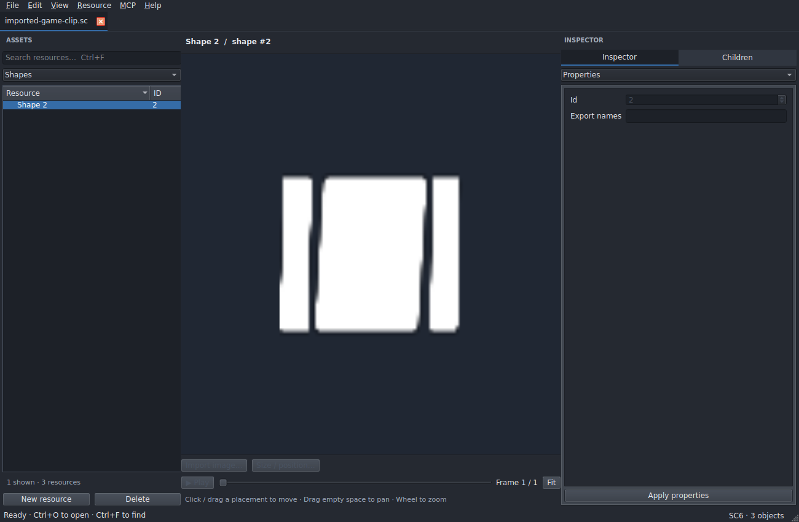
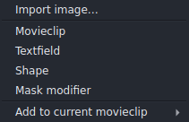

# SC Studio

[](https://github.com/rawnullbyte/SC-Studio/actions/workflows/ci.yml)

A desktop editor for Supercell **SC2** files (versions 5 and 6) — browse, edit and
author resources, and move movieclips between files with their dependency graphs
intact.

Built with Python and PyQt6. Files are read and written losslessly: chunks you
never touch are saved back byte-for-byte.

---

## What it does

| Feature | Description |
| :--- | :--- |
| **Resources** | Movieclips, shapes, textfields, exports and modifiers, with every field in the bundled schemas exposed through Properties, JSON or the geometry editor. |
| **Animation** | A multi-track keyframe timeline with per-object tracks, nine easing curves, tween baking and the engine's own inheritance rule — a frame with no key holds the last pose set. |
| **Textures** | Browse atlases, outline every command that samples them, crop to the region a shape actually uses, and preview ASTC/ETC/BC1/PVRTC/raw atlases. |
| **Create** | Rectangles, rounded rectangles, ellipses, gradient fills, SVG artwork and SVG paths; grouping into animated symbols, nine-slice cutting, parenting, motion guides, colour tweens, matching-topology morphs, text styling and batch export renaming. |
| **Import** | PNG/JPEG/WebP/BMP images, GIF and animated WebP, SVG artwork, and whole resource graphs copied from another open file. |
| **Render** | **View → Rendered effects** (**Ctrl+Alt+R**) plays colour transforms, blend modes, text styles and stencil masks the editable scene does not simulate, with onion skin and PNG/GIF/WebP export. |
| **Publish** | Non-destructive publishing with atlas repacking, low-res variants, embedded or external KTX sidecars, SC5/SC6 output and JSON presets. |
| **Agents** | An MCP server so an agent can inspect and author the same documents you have open. |

## Screenshots

| Light | Dark |
| :---: | :---: |
|  |  |

| Reference tree | Scaling-grid popup |
| :---: | :---: |
|  |  |

| Atlas region outlines | Atlas picker |
| :---: | :---: |
|  |  |

| MCP menu | Create menu |
| :---: | :---: |
|  |  |

## Install

Python 3.10 or newer.

```bash
python -m venv .venv
source .venv/bin/activate          # Windows: .venv\Scripts\activate
python -m pip install .
sc-studio
```

Open a file straight away with `sc-studio /path/to/ui.sc`. The install adds the
`sc-studio` and `sc-studio-mcp` commands; `sc-studio --help` lists the options.

<details>
<summary>Development without installing</summary>

```bash
python -m pip install -r requirements.txt
python run.py
```
</details>

Qt needs a working graphical desktop — this is a desktop app, not a web UI. A
platform-plugin error on Linux usually means Qt's XCB/Wayland runtime libraries
are missing. On Arch, the system packages `python-pyqt6`, `python-pillow`,
`python-flatbuffers` and `python-zstandard` work, with `texture2ddecoder` in a
virtual environment.

## Publishing from the command line

```bash
sc-studio-publish ui.sc -o published.sc
sc-studio-publish first.sc second.sc -o combined.sc --preset settings.json
sc-studio-publish additions.sc -o merged.sc --merge original.sc
```

Linked symbols are the default; `--all` includes every resource. Output is a JSON
summary. Choose an output name distinct from the inputs — the GUI and the CLI
both refuse to publish over a source file, so a publish never edits what you are
working on.

## Agent access (MCP)

1. Start the editor and open your files.
2. **MCP → Copy client configuration** starts local access and copies a
   ready-to-paste client config. **Start**, **Stop** and **Connection status**
   sit in the same menu.
3. Paste that config into your agent's MCP settings and connect. Keep the editor
   open. The agent's environment needs `sc-studio-mcp` on `PATH`, or an absolute
   path in `command`.

Access is off by default, binds to loopback only, and uses a private per-session
token. The descriptor defaults to `~/.sc-studio/mcp-connection.json`; set
`SC_STUDIO_MCP_CONNECTION` to give another editor instance its own file.

**Start with `guide`.** One call states the data model and its traps — a
placement is `[child_index, matrix_index, color_index]` where `child_index` is
*not* a resource ID, `65535` means "inherit" rather than "no transform", draw
order is the frame's element order with no separate z-index, and
`transform_placement` writes a transform rather than keying a frame.

Beyond that: `document_summary` orients you on a file in one call,
`find_components` shows what already exists to reuse, `batch` runs a sequence in
one round trip, and `set_keys` / `tween` / `get_timeline` cover animation without
a round trip per frame. Agents go through the same undo history and validation as
manual editing, so an agent's edit and yours are the same edit.

Tools use zero-based frame and placement indices. Files are written only when
`save_document` is asked for.

## Working with files

<details>
<summary><b>Copy a movieclip between files</b></summary>

1. Open the source and destination files — each gets its own tab.
2. Select the movieclip by export name or resource ID.
3. Focus the resource browser and press **Ctrl+C** (or **Resource → Copy with
   dependencies**). Ctrl/Shift-click selects several.
4. Switch tabs, focus that browser, press **Ctrl+V**.
5. Save with **Ctrl+S**.

**File → Export selected with dependencies** writes a standalone SC6 containing
just that resource graph. Import handles recursive and shared graphs, remaps IDs,
renames conflicting exports with `_copy2` and up, and embeds external KTX/ZKTX
textures. Each imported atlas is cropped to the region its shapes actually sample
— on whole ASTC blocks, copied verbatim, so the result decodes to exactly the same
pixels with no re-encoding. On a large UI file that cut imported texture bytes by
roughly 69% across 25 clips.
</details>

<details>
<summary><b>Import an image or an animation</b></summary>

**Import image…** (**Ctrl+Alt+I**) takes a PNG/JPEG/WebP/BMP, creates the texture
and shape, adds a child and places it at the original resolution.

**Import animation (GIF/WebP)…** (**Ctrl+Alt+A**) turns each source frame into a
movieclip frame, all packed into one atlas, with a configurable name
prefix/suffix and framerate. Video formats are not decoded.
</details>

<details>
<summary><b>Texture atlases</b></summary>

Every draw command that samples the open atlas is outlined, so the whole sheet is
browsable — double-click to open a shape, right-click for usages or its reference
tree. Most commands in a real atlas are *zero-area* (all four corners sample one
texel); those are drawn as small pickable diamond markers, which keeps shapes
that would otherwise be invisible reachable.
</details>

<details>
<summary><b>Keyframe animation</b></summary>

Every child gets its own labeled track under a shared ruler.

- **Drag the playhead** to scrub — it moves the cursor only, never creating a key.
- **Click a key** to select; **Ctrl-click** adds or removes; **Shift-click**
  extends a range.
- **Drag a key** to another frame; dropping onto an occupied frame swaps the two
  poses. Dragging past the end extends the clip.
- **Right-click** a key for per-key actions, or a track/ruler for frame actions
  and curve application.

X/Y/Rotation/Scale fields below the timeline show the selected track's transform;
**Key transform** writes it as a keyframe. Pick a curve, choose how many frames
to write between keys, then **Apply to range**. The format stores one discrete
transform per frame and has nowhere to record a curve, so curves are baked into
frames — the game reads ordinary frames.
</details>

## Interface

The menu bar is **File, Edit, View, Resource, Create, MCP, Help**. The right
sidebar holds one panel at a time, picked from the **INSPECTOR** dropdown:
**Children**, **Properties**, **Timeline**, **JSON**, **Textures**, **Geometry**
(**Ctrl+1**–**Ctrl+6**). Children leads, since a movieclip is mostly the things
it is made of.

**Ctrl+F searches the pane you are in** — assets in the browser, the inline
filter in Children, matching rows in Frames/Placements, text in the JSON editor.
**Ctrl+Shift+P** opens the command palette. **The mouse's side buttons are undo
and redo**, which Qt does not map by default. **F1** lists every shortcut.

**Single letters are shortcuts, except while typing.** **G** opens *Go to ID*,
**X** opens *Find usages* on whatever is focused — a placement picked in the
preview or the list, otherwise the open resource.

**Copy, Duplicate and Delete follow the pane you are in.** A placement picked in
the preview counts as focused, so **Del** removes whatever you clicked in the
canvas. With Children or Placements focused they act on that child; with a frame
picked, or the timeline focused, Delete removes that frame, the picked keys, or
the frame under the playhead — never the movieclip.

A **Snap to pixels** toggle (on by default, remembered) lands dragged placements
on whole asset pixels. A click that does not move the pointer never moves a
placement — only an actual drag does.

**View → Theme** offers System, Light and Dark plus sixteen named schemes (Nord,
Catppuccin, Dracula, Monokai, One Dark, GitHub, Solarized, Gruvbox, Tokyo Night,
One Light and more). Each scheme's colors come from its own project and are
mapped onto Qt palette roles here, so no third-party code or data is bundled.
Theme, geometry, splitter sizes and recent files persist in the platform settings
store.

<details>
<summary><b>Textfield flags</b></summary>

Style bits: `1` device font, `2` outline, `4` bold, `8` italic, `16` multiline,
`32` unknown, `64` auto kern. Alignment is a packed bitfield — horizontal in the
low two bits (left, center, right, justify), vertical in the next two — and is
edited on two named dropdowns in **Properties**, applied live in the preview.
Font and outline colors are packed `0xAARRGGBB` and edited with a color swatch.
Unrecognized enum values are retained, not normalized away.
</details>

## Support boundaries

| Area | Status |
| --- | --- |
| SC2 version 5 | Create, read, edit, write |
| SC2 version 6 | Default for new and exported files; external transform banks preserved |
| Movieclips, shapes, textfields, exports, modifiers | All bundled schema fields retained and exposed |
| Float/half matrices and color transforms | Read and preserve; edits use float matrices |
| SC6 packed matrices and compressed frames | Decoder implemented; original data preserved |
| Embedded and external textures | Preserved; imported sidecars copied |
| Raw RGBA/4444/RGB5A1/RGB565/LA/L | Preview and PNG export |
| KTX1 ASTC/ETC/BC1/BC3/PVRTC | Preview decoder; encoded bytes preserved on save |
| SCTX and unsupported KTX encodings | Preserved and copied; no preview |
| Legacy SC1 / tag-based files | **Not supported** — clear error on open |
| Unknown newer FlatBuffers fields | Opening rejected, to prevent silent field loss |
| Game engine rendering | **Approximate preview**, not Titan Engine |

**Not universal SC support.** The format is reverse-engineered. Opaque
DataStorage fields are retained when editing but their meaning is not inferred,
and a revision that adds fields to fixed-size structs needs updated schemas.

**The preview is approximate.** It draws triangle-strip shapes, nested timeline
transforms, text and alpha. It does not simulate RGB multiply/add effects, stencil
masks, blend modes, or engine text outline/typography and font substitution — the
game supplies its own fonts and typography resources, and this editor bundles
none. Those stored properties remain editable and survive saving and import.
Edited files have not been verified inside the game.

**Performance.** The renderer keeps scene instances and shared texture data
between frames, caches meshes (128 MiB) and decoded atlases (640 MiB), and
decodes only the placements a frame needs. Playback advances one frame per tick,
so a heavy frame slows the animation rather than skipping ahead. An edit snapshots
for undo, validates what it touched, then commits. **Help → Performance** shows
the rolling cost of each stage, which is the quickest way to find what a slow file
is spending time on.

## Tests

```bash
python -m pip install pytest
python -m pytest tests -q
```

Most tests run offscreen; set `QT_QPA_PLATFORM=offscreen` on a headless machine.
Tests needing a real SC file are skipped unless one is supplied through the
`SC_SAMPLE` environment variable.

## Format sources and licenses

The implementation uses an independent, schema-driven Python FlatBuffers codec.
The bundled SC2 schemas and packed decoding logic are based on
[SupercellFlash](https://github.com/sc-workshop/SupercellFlash), the backend
referenced by [lilmuff2/X-coder](https://github.com/lilmuff2/X-coder). The newer
[xcoder-tool/XCoder](https://github.com/xcoder-tool/XCoder) and its `sc-py` /
`sc-compression` dependencies were inspected for format and container handling;
their CLI was not wrapped as a substitute for editing.

Inspected revisions:

- SupercellFlash: `41e894d5a20cc17e47fe32db3106c4c1bec60a3e`
- xcoder-tool/XCoder: `c14a7949c198c362a93d931edf1ae96bfa797b2d`
- lilmuff2/X-coder: `285c36067251cb3b118f006329bc94785d09f183`

SC Studio source is GPL-3.0-or-later (`LICENSE`). SupercellFlash's MIT notice is
retained in `THIRD_PARTY_LICENSE.txt`. PyQt6 is separately available under
GPL/commercial terms; all dependencies retain their respective licenses. Extracted
game assets retain their original ownership. See
[FEATURE_COVERAGE.md](FEATURE_COVERAGE.md) for the full plugin comparison.
